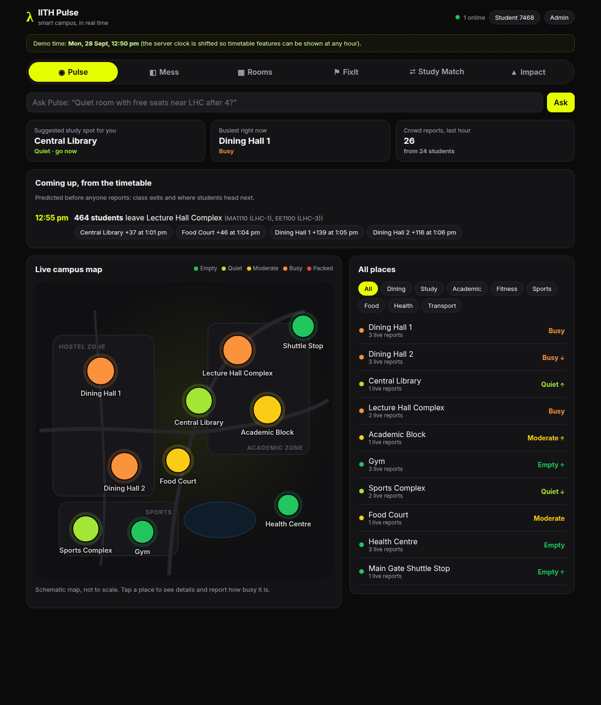
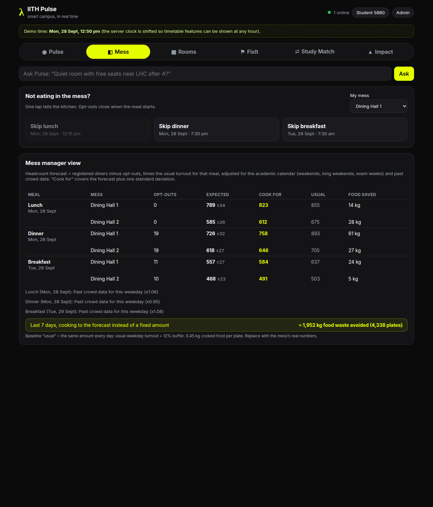
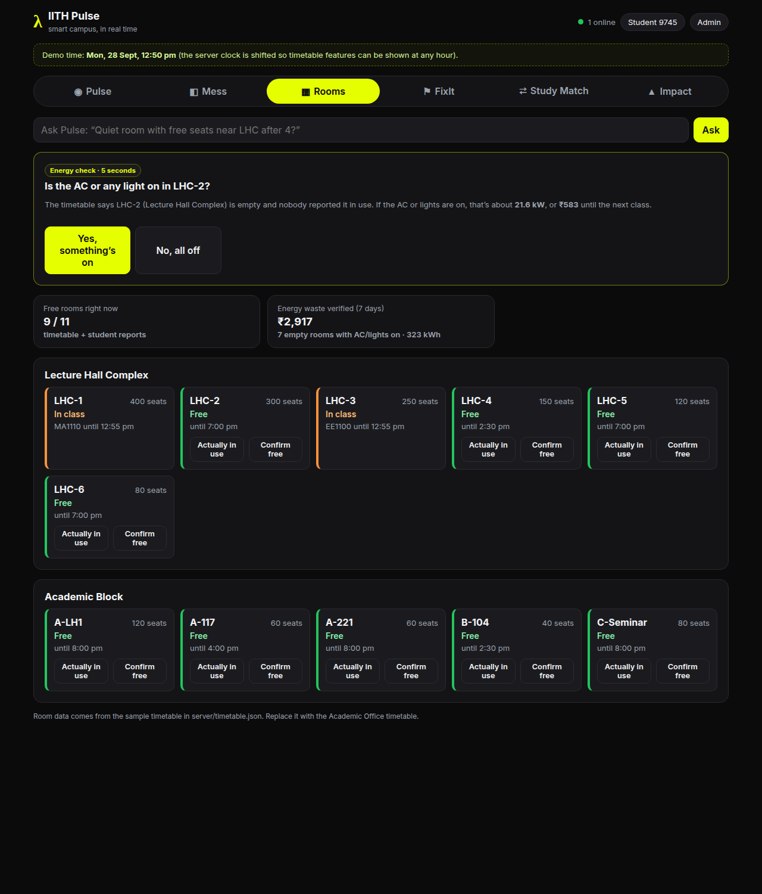
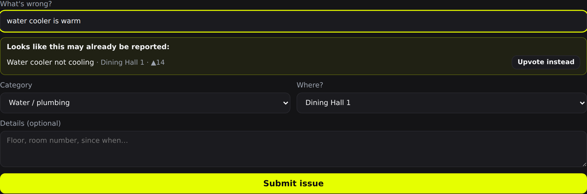
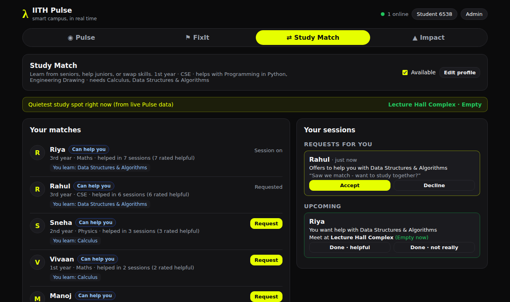
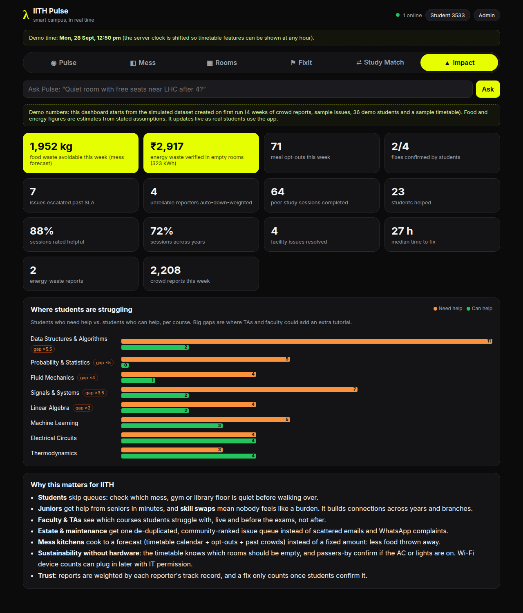
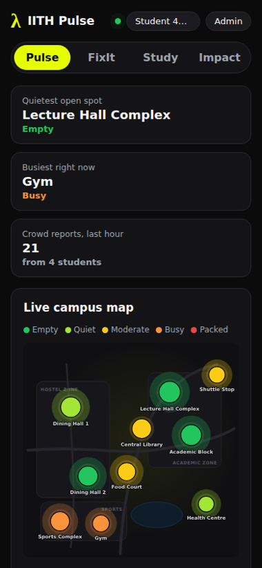

# λ IITH Pulse

Live demo:https://iith-pulse-milan-hackathon.onrender.com

**One app. Every student a sensor.**
A real-time pulse of the IITH campus: see how crowded places are, get broken things fixed faster, and find the right person to study with.

Built for **Lambda Hackathon 2026: Smart Campus Solutions for IITH**.



---

## Contents

- [The problem](#the-problem)
- [What IITH Pulse does](#what-iith-pulse-does)
- [USP: features that feed each other](#usp-features-that-feed-each-other)
- [Impact on the IITH community](#impact-on-the-iith-community)
- [Screenshots](#screenshots)
- [Setup and run](#setup-and-run)
- [Demo walkthrough](#demo-walkthrough)
- [How it works](#how-it-works)
- [Project structure and API](#project-structure)
- [Testing](#testing)
- [Troubleshooting](#troubleshooting)
- [Roadmap](#roadmap)
- [Team](#team)
- [Credits](#credits-and-open-source-used)

---

## The problem

Campus life at IITH still runs on guesswork:

- **Is it crowded?** You walk to the mess, gym or library and only then find out it's packed.
- **Who fixes this?** The same broken water cooler is complained about in five WhatsApp groups and is still broken next week.
- **Who can help me?** Juniors stuck on a course don't know which senior to ask, and seniors who want to help don't know who needs them.

## What IITH Pulse does

| Feature | What it does |
|---|---|
| **Pulse**: live crowd map | Shows how busy dining halls, the library, gym, sports complex, academic blocks and the shuttle stop are **right now**. It predicts the next few hours and suggests the **best time to go**. Students report crowd levels with one tap. |
| **FixIt**: smart issue queue | Report facility problems (water, electrical, Wi-Fi, safety, **energy waste** such as lights or AC left on). Similar existing issues are detected **while you type**, so students upvote them instead of filing duplicates. Issues are ranked by priority, and admins update their status. |
| **Study Match**: peer learning | Students list courses they can help with and courses they need help in. The app matches them and ranks **two-way skill swaps** first ("you teach me Calculus, I teach you DSA"). It suggests the **quietest study spot right now** using live Pulse data, and handles request → accept → meet → rate. |
| **Timetable campus model** | Uses the **real IITH Jul–Nov 2026 timetable** (435 classes, 60 rooms, registered counts and room capacities from the Academic Office classroom sheet) and the **official academic calendar** (segments, holidays, Dussehra break, exams). Predicts crowd surges **before anyone reports**: "691 students leave LHC at 12:55 (AI1000, EE1030, EP1118, …) → Dining Hall 1 +207 at 1:05". Works with **zero taps**, which fixes cold start, and feeds the mess forecast and room finder. |
| **Mess**: forecast + opt-out | One tap: "Skipping dinner tonight". Opt-outs + calendar (weekends, long weekends, exam weeks) + past crowd data → a predicted headcount per meal. The **mess manager view** shows expected headcount (±), "cook for", and the change vs the usual amount: about the same on normal days, **~40% less on long weekends**, **+12–15% in exam week** (avoids shortages). |
| **Rooms**: free-room finder + energy audit | Which classrooms are empty right now and until when (timetable), confirmed by students. Study Match **books** a free room. If a room should be empty, passers-by are asked "Is the AC or light on in LHC-2?"; a yes is auto-verified as waste with a **rupee estimate** and logged in FixIt. No hardware. |
| **Trust-weighted reports** | Every reporter gets a reliability score (Dawid–Skene-style truth discovery). Reports are weighted by it, so trolls fade out without bans, and spam from a fresh account barely moves the level. |
| **Herd-aware suggestions** | If many students were just sent to the "empty" library, the next ones get another place or "go in 20 min". |
| **Verified fixes + escalation** | "Resolved" needs confirmation from the students who upvoted, or it reopens. Issues past their SLA escalate, and the estate office gets an auto-generated **weekly digest**. |
| **IITH login** | Google sign-in restricted to **@iith.ac.in** accounts (checked on the server). Fixes spoofed reports, fake upvotes and the hard-coded admin PIN. |
| **Ask Pulse** | "Quiet room with free seats near LHC after 4?" answered from the other modules (rule-based, no API key). |
| **Impact** dashboard | Food waste avoided, energy waste verified, fixes confirmed, escalations, peer sessions, and a **"where students are struggling"** chart that TAs and faculty can act on. |

All screens update **live** over WebSockets: a report on one phone changes every other screen within about a second. It runs in any browser, on phone or laptop, with nothing to install.

## USP: features that feed each other

Most campus apps do one thing. In IITH Pulse, **every tap does double duty**:

| Students do this… | …and it also powers |
|---|---|
| Report how crowded a place is | the meeting spot for study sessions (the quietest open place) |
| Fill in a study profile | a live view for faculty of which courses the batch is struggling with |
| Upvote an issue | one ranked, de-duplicated maintenance queue for the estate office, and the right to confirm the fix |
| Nothing at all (the timetable) | crowd surge predictions, free rooms, the mess calendar and which empty rooms to check for energy waste |
| Tap "skip dinner" | the mess headcount forecast and kg of food not cooked for nobody |
| Answer "is the AC on?" | verified energy waste in rupees, and a FixIt ticket |

The more students use it, the more accurate and useful every feature becomes.

## Impact on the IITH community

- **Students:** less time wasted in queues. Check before walking across campus.
- **Juniors and seniors:** peer help in minutes. Skill swaps mean nobody feels like a burden, and they build connections across years and branches.
- **Faculty and TAs:** see which courses need an extra tutorial *before* exams, not after.
- **Estate / maintenance:** one prioritised queue instead of scattered emails and WhatsApp complaints, with median fix time tracked.
- **Sustainability:** energy-waste reports turn every student into a sensor for IITH's green-campus goals.

> ⚠️ **About the demo numbers:** on first run the app generates a **simulated** dataset (4 weeks of crowd reports, sample issues, and 36 fictional demo students with past sessions; the timetable and calendar are real, mess sizes are assumptions) so every screen has data. The numbers on the Impact dashboard come from this simulation. They show what the dashboard would report, not measured results. Real use adds real data on top.

## Screenshots

| Mess: one-tap opt-out + manager forecast | Rooms: free-room finder + energy check |
|---|---|
|  |  |

| FixIt: duplicate detection while typing |
|---|
|  |

| Study Match: matches, requests and suggested spot |
|---|
|  |

| Impact dashboard | Mobile view |
|---|---|
|  |  |

---

## Setup and run

**You need:** [Node.js](https://nodejs.org) **version 20 or newer**. There is no database to set up and no API keys.

### 1. Install Node.js

<details>
<summary><b>Ubuntu / Linux</b></summary>

`sudo apt install nodejs` often installs an old version, so use NodeSource instead:

```bash
sudo apt update
sudo apt install -y curl unzip
curl -fsSL https://deb.nodesource.com/setup_22.x | sudo -E bash -
sudo apt install -y nodejs
node -v   # should print v22.x.x
```
</details>

<details>
<summary><b>Windows</b></summary>

Download the **LTS** installer from <https://nodejs.org> and install it with the default options. Then open a new **Command Prompt** and run `node -v`.
</details>

<details>
<summary><b>macOS</b></summary>

Download the LTS installer from <https://nodejs.org>, or run `brew install node`. Check with `node -v`.
</details>

### 2. Get the code and run it

```bash
git clone <your-repo-url> iith-pulse
cd iith-pulse
npm install        # installs everything (root, server and client), about 1-2 min
npm run dev        # starts the API on :4000 and the web app on :5173
```

Open **<http://localhost:5173>** in your browser. Press `Ctrl + C` in the terminal to stop.

### 3. (Optional) Open it on phones

`npm run dev` also prints a **Network** address, for example `http://192.168.1.23:5173`. Open it on any phone on the **same Wi-Fi**.
If phones can't connect, allow the port through your firewall (Ubuntu: `sudo ufw allow 5173`; Windows: click **Allow** when asked).

### Deploy (public URL)

`render.yaml` is included: on [Render](https://render.com) choose **New → Blueprint** and pick the repo. It builds the client, serves everything on one port, generates `ADMIN_PIN` and `SESSION_SECRET` (read the PIN in the Render dashboard), and keeps demo mode on.
- The free plan has **no persistent disk**: data resets on each restart/redeploy and the server re-seeds demo data on boot. That's fine for a demo. For real use, add a Render disk and set `DB_PATH` to it.
- Free instances sleep after ~15 min idle and take ~30–60 s to wake. Open the URL 5 minutes before presenting.
- Railway works the same way: build `npm install && npm run build`, start `npm start`.

### Production mode (one port)

```bash
npm run build      # builds the web app into client/dist
npm start          # serves the app + API on http://localhost:4000
```

### Commands

| Command | What it does |
|---|---|
| `npm run dev` | Run the API and web app with auto-reload |
| `npm test` | Run the automated tests |
| `npm run seed` | Reset the database to fresh demo data |
| `npm run build` then `npm start` | Production build served on a single port |

### Configuration (optional environment variables)

| Variable | Default | Meaning |
|---|---|---|
| `PORT` | `4000` | API port |
| `ADMIN_PIN` | `iith2026` | PIN for admin mode, **only when Google sign-in is off** (local demo) |
| `GOOGLE_CLIENT_ID` | (empty) | Turns on Google sign-in. Create an OAuth *Web* client in Google Cloud Console and add your site to its authorised JavaScript origins. When set, every write needs a signed-in @iith.ac.in account |
| `ALLOWED_DOMAIN` | `iith.ac.in` | Google Workspace domain allowed to sign in (checked via the token's `hd` claim and the email) |
| `ADMIN_EMAILS` | (empty) | Comma-separated admin accounts when sign-in is on (replaces the PIN) |
| `SESSION_SECRET` | (required with sign-in) | Key that signs session tokens, 32+ characters. The server **refuses to start** with `GOOGLE_CLIENT_ID` set and no secret, so there is no guessable fallback. `render.yaml` generates it |
| `ALLOWED_ORIGINS` | (empty) | Extra comma-separated origins allowed to call the API cross-site. `localhost:5173`, `localhost:4000` and Render's `RENDER_EXTERNAL_URL` are always allowed; the built app is same-origin and needs nothing |
| `WRITES_PER_MIN` | `30` | Rate limit per IP on every POST/PUT/PATCH. Raise it if many demo phones share one Wi-Fi IP |
| `TIMETABLE_PATH` | `server/timetable.json` | Timetable + academic calendar |
| `TARIFF_INR_PER_KWH` | `9` | Electricity tariff for the energy-waste estimate |
| `MESS_USUAL_BUFFER` | `0.05` | Baseline "usual" cooking = typical weekday/weekend turnout + this buffer |
| `DEMO_MODE` | `true` | Adds a simulated crowd report every 20 s. Demo students accept your study requests after ~4 s, and one sends you a request ~8 s after you create a profile, so every flow can be shown on one laptop. Set to `false` for real use. |
| `TZ_OFFSET_MIN` | `330` | Campus time zone offset in minutes (IST) |
| `DB_PATH` | `server/data/db.json` | Where data is stored |

Example: `DEMO_MODE=false ADMIN_PIN=secret npm start`

---

## Demo walkthrough

A 3-minute script. Click **Admin** (PIN `iith2026` in the local demo) to get the **demo clock**, which shifts the server time so the timetable features work at any hour.

1. **Timetable, no taps.** Demo clock → **Mon 12:50**. Pulse shows *"12:55 pm: 691 students leave Lecture Hall Complex (AI1000, BT6390, EE1030/EE2100 +4 more) → Dining Hall 1 +207 at 1:05 pm"*, from the real timetable, before anyone reports.
2. **Food waste.** Open **Mess** on 5 phones (or 5 browser profiles) and tap **Skip dinner**. The mess manager view's headcount drops live, and "cook for" and kg saved update. Demo clock → **Fri 2 Oct 18:00** shows the long-weekend drop.
3. **"What if someone lies?"** Pulse → tap **Central Library** → **Demo: spam "Packed" from a new account**. The toast shows the level barely moving (the new account's trust is ~13%). Recent reports show each reporter's trust.
4. **Free room finder.** Study Match: create a profile and **Request** a match. When the demo student accepts, the session is **booked into a free classroom** (see it turn purple in **Rooms**).
5. **Energy audit.** Rooms: *"Is the AC or any light on in LHC-2?"* → **Yes**. It's auto-verified (timetable says empty, nobody reported it in use), shown in rupees, and a FixIt ticket appears.

Also worth showing: FixIt **Past SLA** filter, the **Weekly digest** button (admin), a resolved issue asking its upvoters "Is it really fixed?", and the Ask Pulse box: *"Quiet room with free seats near LHC after 4?"*

Tip: run `npm run seed` just before a presentation to reset the demo data.

---

## How it works

```
 React (Vite)  ──REST──▶  Express API  ──▶  JSON datastore (server/data/db.json)
      ▲                        │
      └──── Socket.IO ◀────────┘   live push: pulse:update · issues:update · study:update · mess:update · rooms:update · clock
```

### Timetable campus model: `server/src/campus.js` + `server/timetable.json`
- **Input:** `server/timetable.json`: rooms (building, seats), classes (course, room, sessions, **registered count**, segment) and the calendar (the 6 teaching segments, holidays, the 19–23 Oct break, exams 14–18 Nov). A course only runs in its segments (e.g. a "3-6" course starts 31 Aug).
- **Source:** imported from the Academic Office "Classroom Details" sheet (Jul–Nov 2026) with `node server/scripts/import-timetable.mjs <csv>`. The importer cleans messy room cells ("CHE-118 Class Room 118-Capacity-84" → CHE-118, 84 seats), merges cross-listed courses sharing a room, and caps enrollment at room capacity. Re-run it each semester. The raw CSV is kept in `server/data/`.
- **Occupancy:** students in class = enrollment × 80% attendance, per building.
- **Surges:** when a class ends, a time-of-day share of students walks to each destination (lunch-time exits → dining halls; 5 pm exits → sports, gym, food court). Walking time comes from map distance; each destination has a dwell time. Grouped into "N leave X at 12:55 → +M at Y at 1:05".
- **Zero taps:** the expected level for a place is the historical forecast floored by the timetable estimate, and it's the prior for the live level. A place with no history at all still gets a level from the timetable.
- **Calendar:** weekends, holidays, **long weekends** (3+ days off in a row) and **exam weeks** (no classes) drive the mess forecast and turn class predictions off.

### Trust-weighted reports: `server/src/trust.js`
- A small **Dawid–Skene-style truth discovery** loop (3 EM-like rounds): estimate the truth at each report as the trust-weighted mean of *other* reporters' levels within ±20 min (or the timetable/history forecast if nobody else reported), then score each reporter by how often they agree with it.
- Trust = (agreements + 0.5) / (reports + 4), so a **fresh account starts at 12.5%**. In the demo data, honest reporters score ~0.8 and simulated trolls ~0.4.
- A report's weight is **trust²** (log-odds-like sharpening): honest 0.64, troll 0.15, fresh account 0.016. Spam "Packed" from a new account moves a Quiet place by ~0.0 levels.
- The historical forecast only uses reports from **before today**, so fresh (possibly spam) reports can't shift the prior they're judged against.
- Only each reporter's **latest** report counts toward the live level, weighted by their trust. A 1-minute anti-flood rate limit remains; the old 5-minute cooldown is gone.

### Crowd model: `server/src/forecast.js`
- Students report a level from **1 (Empty)** to **5 (Packed)**.
- **Live level:** the recency- and trust-weighted average of reports from the last 45 minutes (15-minute half-life), **blended with the expected level** (history + timetable) as a prior, so one outlier report can't flip a place from Empty to Packed.
- **Forecast:** the average historical level for the same weekday and hour. If there isn't enough data, it falls back to the same hour on any day.
- **Best time:** the least crowded *open* hour in the next 6 hours.
- **Herd-aware suggestion** (`/api/suggest`): if everyone recently sent to a place might show up (60% assumed), would it pass half its capacity? Then the next student gets the next-quietest place, or "go in 20 min".

### Mess forecast: `server/src/mess.js`
- Headcount = (registered − opt-outs) × turnout rate. The rate depends on the meal (breakfast 55%, lunch 78%, dinner 82% on weekdays; lower on weekends), ×0.6 on a long weekend, ×1.08–1.2 in exam week, and ×0.85–1.15 from past crowd data for that weekday.
- ± is binomial noise plus 4% model error. **Cook for** = expected + 1 SD.
- **Baseline ("usual")** = a mess that already knows weekday vs weekend turnout and adds a 5% buffer, but not long weekends, exam weeks or opt-outs. Deliberately conservative. The UI shows the **% change vs usual** per meal; kg (× 0.45 kg/plate) is secondary.
- Result on the real calendar: normal days ≈ 0–2% less; **long weekends ≈ 40% less**; exam week **+12–15%** (cook more, avoid shortages). Weekly figure is small on purpose; the pitch is the long-weekend and exam-week cases.
- Registered diners (950 / 750) and turnout rates are **assumptions**: one mess manager's real numbers (registered, plates cooked, rough leftover) should replace them in `places.js` / `mess.js`.
- Opt-outs are for the next three meals and close when the meal starts.

### Rooms and energy audit: `server/src/campus.js`
- Room state: **in class** (timetable) → **booked** (Study Match) → **reported in use** (student report in the last 30 min) → **free until** the next class or booking.
- The app asks a passer-by about one free room nobody checked in the last hour. "Yes, it's on" is **auto-verified** if the timetable says the room is empty and nobody reported it in use. Waste = (AC kW + lights) × hours until the next class (max 3 h) × tariff. It also opens or upvotes a FixIt energy ticket for that room.

### Security
- **helmet** security headers with a Content-Security-Policy that only allows this site, Google Fonts and Google sign-in.
- **CORS** limited to localhost and the deployed URL (API and Socket.IO).
- **Rate limits:** 30 writes per minute per IP on every POST/PUT/PATCH; **5 wrong admin PINs per 15 minutes** per IP, whether sent to `/api/admin/verify` or as a header. PIN comparison is constant-time. Behind Render's proxy the real client IP is used.
- **No user IDs in live events:** Socket.IO events carry only place/issue/room IDs; `study:update` carries nothing, and each client reloads its own requests. Issue lists never include reporter or voter IDs.
- `npm audit`: 0 vulnerabilities in root, server and client (28 Sep 2026).
- Known and accepted for the hackathon: in anonymous mode (sign-in off) the server trusts the browser's random ID; study profiles show first names; the session token is in localStorage (React escapes content, so XSS is unlikely).

### Identity: `server/src/auth.js`
- The browser gets a Google ID token (Google Identity Services, `hd=iith.ac.in`). The server verifies it with Google, checks the audience, a verified email and the **`hd` claim = iith.ac.in** (a gmail.com account can't fake it), then issues its own HMAC-signed session token. All routes use the session identity, not a `user` field from the request body.
- With no `GOOGLE_CLIENT_ID` (local demo), the old anonymous browser IDs and admin PIN still work.

### FixIt: `server/src/issues.js`
- **Priority** = 1.5 × upvotes + 2 × category severity (safety > water/electrical > energy/Wi-Fi > …) + age in days (capped at 10) + 4 × SLA escalation level, so old unresolved issues keep rising.
- **SLA:** each category has hours to fix (safety 24 h, water 48 h, Wi-Fi 72 h, furniture 7 days…). Past it → level 1; past twice it → level 2. The clock restarts when an issue reopens.
- **Verified fixes:** when an admin marks an issue resolved, the students who reported or upvoted it are asked "Is it really fixed?". Two confirmations (or all voters, if fewer) → **verified**. More "still broken" than "fixed" → **reopened**. No reply in 48 h → counted as verified.
- **Weekly digest:** every Monday 9 am the server stores a plain-text digest for the estate office: new, resolved, confirmed, reopened, escalated issues and verified energy waste. Admins can preview it any time.
- **Duplicate detection:** keyword (Jaccard) similarity, plus a boost for the same place and category. It runs as you type.

### Study Match: `server/src/study.js`
- For each available student: **youLearn** = courses you need ∩ courses they can teach, and **youTeach** = courses they need ∩ courses you can teach.
- **Score** = 2 × youLearn + 1.5 × youTeach + **3 if it's a two-way swap** + reputation bonus (their helpful-rated sessions, capped) + 0.5 if active this week.
- **Meeting room:** when a session is accepted, the smallest classroom that the timetable says is free for the next hour is **booked** for it (and released when the session is marked done). If none is free, it falls back to the quietest open study place.
- **Struggle map:** for each course, students who need help vs. students able to help. A big gap flags where an extra tutorial is needed.

### Customising for IITH
- **Places** (names, positions on the map, capacity, opening hours): `server/src/places.js`
- **Courses:** `server/src/study.js` (`COURSES`)
- **Timetable, rooms and calendar:** `server/timetable.json`, imported from the Academic Office sheet (see above). Update the `calendar` block from the academic calendar PDF each semester.
- **Mess sizes:** `registered` in `server/src/places.js`
- After editing, run `npm run seed` to regenerate the demo data.

<a id="project-structure"></a>
## Project structure

```
iith-pulse/
├── package.json            # root scripts: dev / build / start / test / seed
├── docs/screenshots/       # images used in this README
├── server/
│   ├── src/
│   │   ├── index.js        # HTTP + Socket.IO server, demo simulator
│   │   ├── app.js          # REST API routes + input validation
│   │   ├── forecast.js     # crowd model (pure functions)
│   │   ├── campus.js       # timetable model: surges, free rooms, energy waste, herd
│   │   ├── trust.js        # reporter reliability (truth discovery)
│   │   ├── mess.js         # meal headcount forecast + food waste
│   │   ├── auth.js         # Google sign-in (@iith.ac.in) + signed sessions
│   │   ├── ask.js          # "Ask Pulse" question answering
│   │   ├── clock.js        # server clock (demo time travel)
│   │   ├── issues.js       # priority, duplicates, SLA, verified fixes, digest
│   │   ├── study.js        # study matching, reputation, course demand
│   │   ├── places.js       # campus places (edit to match IITH)
│   │   ├── seed.js         # simulated demo data generator
│   │   └── db.js           # tiny JSON datastore (atomic writes)
│   ├── timetable.json      # real IITH Jul–Nov 2026 timetable + academic calendar
│   ├── scripts/import-timetable.mjs  # Academic Office CSV -> timetable.json
│   ├── data/classroom-details-jul-nov-2026.csv  # raw source sheet
│   └── test/core.test.js   # unit + API tests
└── client/
    ├── vite.config.js      # dev server + proxy to the API
    └── src/
        ├── App.jsx         # app shell, tabs, admin mode
        ├── api.js, socket.js, util.js
        └── components/     # Pulse, Mess, Rooms, FixIt, Study, Impact, Ask, CampusMap, HourBars
```

### API

| Method | Endpoint | Description |
|---|---|---|
| GET | `/api/pulse` | All places with live level, trend and best time |
| GET | `/api/places/:id` | Place detail: 12-hour forecast, today's profile, recent reports |
| POST | `/api/reports` | Report a crowd level `{ placeId, level (1-5) }`; returns the level before and after |
| GET | `/api/issues?status=&sort=` | Issue list, by priority or newest |
| POST | `/api/issues/similar` | Possible duplicates for a draft issue |
| POST | `/api/issues` | Create an issue |
| POST | `/api/issues/:id/upvote` | Toggle an upvote |
| PATCH | `/api/issues/:id` | Change status (admin: `ADMIN_EMAILS` session, or `x-admin-pin` in the local demo) |
| GET / PUT | `/api/study/profile` | Read or save a study profile |
| GET | `/api/study/matches?user=` | Ranked matches + the quietest study spot now |
| GET | `/api/study/requests?user=` | Incoming, outgoing, upcoming and past sessions |
| POST | `/api/study/requests` | Send a session request `{ user, to }` |
| POST | `/api/study/requests/:id/respond` | Accept or decline `{ user, accept }` (recipient only) |
| POST | `/api/study/requests/:id/complete` | Mark done `{ user, helpful }` |
| GET | `/api/impact` | Dashboard metrics |
| POST | `/api/auth/google` | Exchange a Google ID token for a session `{ credential }` (@iith.ac.in only) |
| GET | `/api/trust` | Your reporter trust score |
| GET | `/api/suggest?kind=study` | Herd-aware place suggestion: `now` or `in 20 min` |
| GET | `/api/rooms` | Room states, free-until times, the energy check question, energy totals |
| POST | `/api/rooms/:id/report` | Report a room in use / free `{ busy }` |
| POST | `/api/rooms/:id/audit` | Answer the energy check `{ on }` |
| GET | `/api/mess` | Next three meals: forecast per mess, your opt-outs, kg saved this week |
| POST | `/api/mess/optout` | Skip (or un-skip) a meal `{ meal, date, mess, skip }` |
| POST | `/api/issues/:id/verify` | Upvoter confirms or disputes a fix `{ fixed }` |
| GET | `/api/digest` | Weekly estate-office digest (admin) |
| POST | `/api/ask` | Ask Pulse `{ q }` |
| POST | `/api/demo/clock` | Demo only, admin: shift server time `{ at }` or `{ at: null }` |

With sign-in on, send `Authorization: Bearer <token>`; the `user` field in bodies and queries is ignored.

---

## Testing

```bash
npm test
```

The 19 automated tests (Node's built-in test runner, no extra dependencies) cover:
- the crowd model: forecast fallback, outlier damping, best-time selection
- the timetable model (on a small fixture): the 12:55 exit predicting a dining-hall surge, cold start with zero reports
- the real timetable + calendar: segment 4 on 28 Sep, Gandhi Jayanti long weekend, Dussehra break, exams, the real 12:55 LHC exit
- the timetable importer: messy room cells, timings, cross-listed courses
- the mess forecast: opt-outs and long weekends lower the headcount, "cook for" covers the forecast
- trust: trolls lose weight; spam from a fresh account moves the level < 0.2 (with or without other live reports, and through the API)
- free rooms (class / booked / reported in use / free until), herd staggering
- FixIt: duplicate detection, priority, disputes reopen, confirmations verify, SLA escalation levels
- auth: tamper-proof session tokens, non-IITH and wrong-audience Google tokens rejected
- Ask Pulse parsing
- security: write rate limit, 5-wrong-PIN lockout (body and header), CORS allow-list, security headers, no reporter/voter IDs in API responses
- a full API flow: rate limiting, issue create/upvote/admin status (with and without PIN), fix verification, meal opt-out, and study profile → match → request → accept → complete

## Troubleshooting

| Problem | Fix |
|---|---|
| `node: command not found` / `'npm' is not recognized` | Install Node.js (see [Setup](#1-install-nodejs)), then open a new terminal. |
| `node -v` shows v18 or lower | Install Node 20+ using the NodeSource steps above. |
| `Port 4000/5173 already in use` | Another copy is running. Stop it (`Ctrl + C`) or close that terminal. |
| Browser says "Can't reach the Pulse server" | The API didn't start. Check the terminal for a red error. |
| Phones can't open the Network URL | Make sure they are on the same Wi-Fi, and allow port 5173 through the firewall. |
| Want a clean slate | `npm run seed` |

## Roadmap

- **Automatic occupancy** from Wi-Fi access-point connection counts (data access only, with IT permission), feeding the same trust-weighted model
- **LLM fallback for Ask Pulse** (free-tier API) for questions the rules don't cover
- **Real timetable + mess registration import** from the Academic Office and mess committee
- **Push notifications**: "Gym is quiet right now", "Your study request was accepted"
- **Study groups** (3–5 students per course) and TA office-hour suggestions from the struggle map
- **Postgres** storage for campus-wide deployment

## Team

| Name | Role |
|---|---|
| _add name_ | _add role_ |
| _add name_ | _add role_ |

## Credits and open source used

[React](https://react.dev), [Vite](https://vitejs.dev), [Express](https://expressjs.com), [Socket.IO](https://socket.io), [cors](https://github.com/expressjs/cors), [concurrently](https://github.com/open-cli-tools/concurrently), and the [Inter](https://rsms.me/inter/) font via Google Fonts. These are MIT/OFL licensed. All other code was written during the hackathon.

## License

[MIT](LICENSE)
